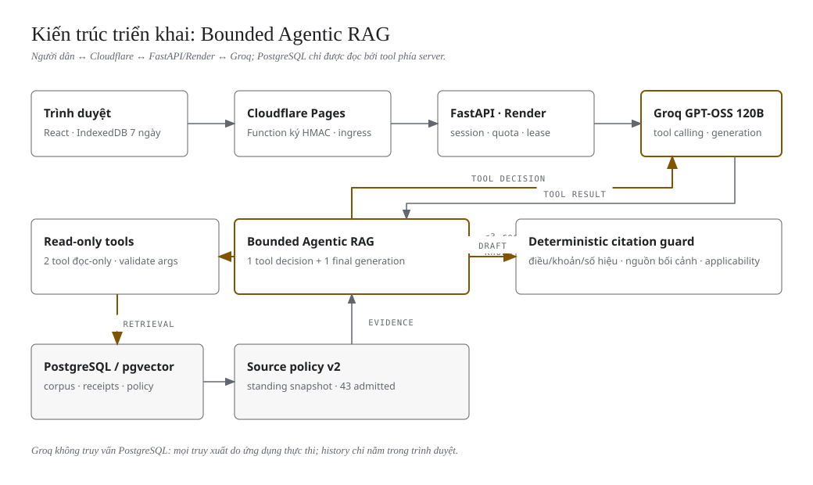
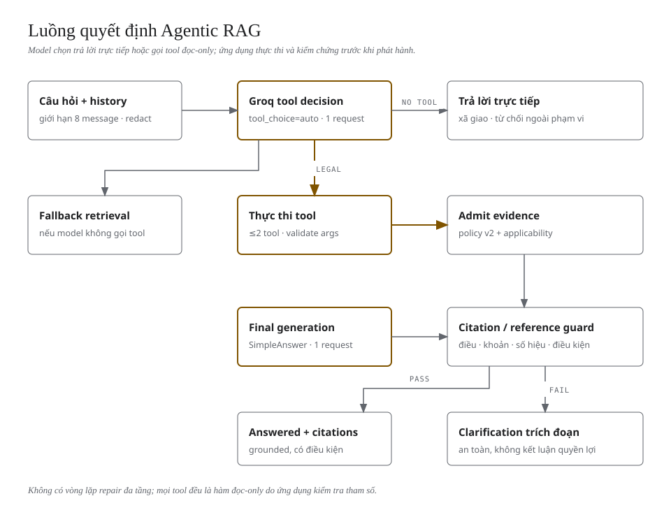
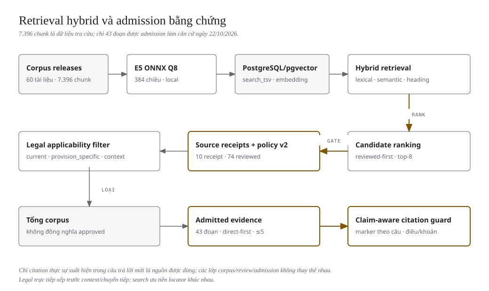

# Hanoi Land Law Assistant — Vành đai 4

Trợ lý hội thoại tiếng Việt hỗ trợ tra cứu pháp luật đất đai liên quan đến dự án Vành đai 4 tại Hà Nội: thu hồi đất, bồi thường, hỗ trợ, tái định cư, quy hoạch và thủ tục. Câu trả lời pháp luật chỉ được dựng từ các đoạn nguồn đã review và còn đủ điều kiện áp dụng; hệ thống không xác định thửa đất, không tính tiền, không kết luận quyền lợi cá nhân.

> **Phạm vi học thuật.** Đây là MVP phục vụ báo cáo đại học. Hệ thống chưa có thẩm định pháp lý độc lập, coverage nguồn còn một phần, và các kết quả đánh giá chỉ dựa trên mẫu nhỏ. Không dùng làm tư vấn pháp lý chính thức.

## 1. Live demo

- Ứng dụng: **https://hanoi-land-law.pages.dev/**
- Runtime production: `EXECUTION_MODE=agentic_rag` (bounded Agentic RAG).
- Source đang chạy: `b1c10f4bad6b89f1d555eb08f5216b4b285be6d6`.
- Corpus: `corpus-1afca764aa6692e0`; standing source policy v2 SHA `7e6ec4c4f581c9e8e7355288f7f76e61f67bdaed67d95f68d7d541c5b256983d`.
- Kết quả release gần nhất: [FINAL_RESULT.md](reports/evaluation/agentic-rag-final/FINAL_RESULT.md) · [metrics.json](reports/evaluation/agentic-rag-final/metrics.json).

> **Trạng thái 22/10/2026:** các mô tả claim-aware guard, fallback ngắn, evidence ordering và bốn gợi ý mới dưới đây phản ánh **hotfix candidate** trên branch `fix/legal-answer-grounding-hotfix`, chưa deploy. Production `b1c10f4` vẫn dùng guard citation toàn cục, fallback trích đoạn cũ và bốn gợi ý cũ cho tới khi release được duyệt.

## 2. Bài toán và phạm vi

Người dân hỏi bằng ngôn ngữ tự nhiên, thường thiếu dữ kiện và hay hỏi tiếp ("vậy nếu chưa có sổ đỏ?", "đất tôi ở thuộc dự án Vành đai 4"). Yêu cầu cốt lõi:

- Hiểu câu hỏi và ngữ cảnh hội thoại, không bắt người dùng dùng cú pháp đặc biệt.
- Phân biệt quy hoạch với quyết định thu hồi, điều kiện bồi thường với hình thức bồi thường, hỗ trợ với tái định cư.
- Chỉ dùng nguồn đã review và còn hiệu lực; không bịa điều/khoản, số tiền hay quyền lợi.
- Trả lời có điều kiện hoặc hỏi làm rõ khi thiếu dữ kiện; không từ chối chung chung khi đã có nguồn.

## 3. Năng lực chính

- Hội thoại tiếng Việt, có history giới hạn và follow-up theo ngữ cảnh.
- Trang đầu có bốn gợi ý ngắn về năng lực trợ lý, bồi thường đất ở, hỗ trợ đất nông nghiệp và tái định cư; chọn chỉ điền câu hỏi, không tự gửi.
- Model tự chọn trả lời trực tiếp hoặc gọi tool đọc-only; ứng dụng kiểm tra tham số và thực thi.
- Tool `search_legal_evidence` và `open_legal_provision` trả đoạn nguồn kèm số hiệu, điều/khoản, URL và trạng thái áp dụng.
- Citation inline `[S1]`… bắt buộc cho **câu khẳng định** pháp lý; câu hỏi làm rõ và câu nêu giới hạn không cần marker. Guard deterministically kiểm tra điều/khoản/số hiệu văn bản, điều kiện thêm vào và nguồn bối cảnh; chấp nhận nhóm marker như `[S1, S2]` nhưng từ chối ID ngoài context.
- Thư viện văn bản, panel nguồn, citation mở được URL công bố, lịch sử hội thoại trong IndexedDB 7 ngày.
- Session ẩn danh, signed ingress HMAC, quota theo session/IP, giới hạn LLM/token/concurrency.
- Chế độ `simple_rag` giữ làm rollback; mode legacy `agentic` (LangGraph) chỉ còn cho tương thích.

## 4. Kiến trúc triển khai



Trình duyệt → Cloudflare Pages/Pages Function (ký HMAC) → FastAPI trên Render → Bounded Agentic RAG. Model gọi Groq; ứng dụng thực thi tool đọc-only; PostgreSQL/pgvector chỉ được đọc bởi server. Citation guard chạy trước khi phát hành câu trả lời.

## 5. Công nghệ và vai trò

| Thành phần | Vai trò |
|---|---|
| React + TypeScript + Vite | Giao diện chat, thư viện nguồn, panel citation, history IndexedDB |
| Cloudflare Pages + Pages Functions | Phục vụ frontend, proxy `/api/*`, ký ingress HMAC tới Render |
| FastAPI + Pydantic | API, session, quota, SSE, orchestration Agentic RAG |
| Bounded Agentic RAG (`backend/landlaw/agentic_rag.py`) | Model-driven tool decision + final grounded generation |
| Groq `openai/gpt-oss-120b` | Tool calling và sinh câu trả lời |
| E5 ONNX Q8 (`multilingual-e5-small-onnx-q8-window-v1`) | Embedding 384 chiều chạy local |
| PostgreSQL/pgvector trên Supabase | Corpus, chunk, embedding, release, source review/app_state |
| Render Free Docker | Chạy FastAPI production |
| pytest / Vitest / Playwright / GitHub Actions | Kiểm thử và CI/CD |

## 6. Luồng Bounded Agentic RAG



1. Nhận câu hỏi + history giới hạn.
2. Một request tool-decision tới Groq (`tool_choice="auto"`).
3. Nếu là xã giao: trả lời trực tiếp, không retrieval.
4. Nếu là pháp luật: ứng dụng thực thi tool do model chọn (tối đa 2 tool), admission bằng chứng qua policy/ngày hiệu lực; nếu model không gọi tool, ứng dụng fallback retrieval. Đoạn trực tiếp về bồi thường/hỗ trợ/tái định cư/Luật Đất đai được xếp trước nghị quyết chuyển tiếp; tối đa một đoạn tin/dự án context và ưu tiên locator khác nhau.
5. Một request final generation với schema `SimpleAnswer`.
6. Guard kiểm tra citation/reference theo từng câu khẳng định. Nếu không đạt, trả clarification ngắn chỉ nêu danh tính nguồn và tối đa một câu hỏi; không đổ trích đoạn nguyên văn và không kết luận quyền lợi.

Hard guard: tối đa 3 LLM request/lượt (bình thường 1–2), tối đa 2 tool execution, không repair loop, không có tool-decision thứ hai. Chi tiết: [docs/AGENTIC_RAG.md](docs/AGENTIC_RAG.md).

## 7. Model-driven tool selection

- `search_legal_evidence`: tìm đoạn đã review theo câu truy vấn (model có thể viết lại theo ngữ cảnh).
- `open_legal_provision`: mở đúng `document_id` + `locator` để đọc thêm một điều/khoản.
- Mọi tham số được validate server-side; model không có SQL, ghi DB, filesystem, URL tùy ý hay credential.
- Câu pháp luật không thể phát hành đáp án trực tiếp không qua evidence: nếu model trả lời trực tiếp, ứng dụng bắt buộc retrieval rồi mới generation.

## 8. Retrieval và source-grounding



- Retrieval hybrid: lexical (`search_tsv`), semantic (pgvector/E5), heading/article index.
- Candidate ranking có nhánh ưu tiên đoạn đã review để không bị top-K của tài liệu chưa review lấn át.
- Đoạn chỉ được dùng khi: receipt mới nhất khớp policy, checksum khớp release, policy v2 cho phép (standing hoặc legal window), và `applicability()` trả `current`/`provision_specific`/`context`.
- Với câu hỏi pháp lý, văn bản trực tiếp về bồi thường/hỗ trợ/tái định cư/Luật Đất đai được xếp trước nghị quyết chuyển tiếp; nếu có đoạn trực tiếp, tối đa một đoạn tin/dự án context được giữ. Search ưu tiên locator khác nhau trước khi lấp slot bằng chunk trùng điều.
- Số liệu hiện tại: 60 tài liệu, 7.396 chunk, 10 tài liệu có receipt, 74 đoạn reviewed, **43 đoạn admitted** ngày 22/10/2026. `source_fresh=false`, warning `source_partial_review`; không có expiry 24h/72h/7d.
- Tin chính thức/dự án chỉ là context, không chứng minh quyền lợi hộ dân.

## 9. History và follow-up

- History do trình duyệt sở hữu trong IndexedDB, TTL 7 ngày; server không lưu message, answer cache hay trace chi tiết.
- Client gửi tối đa 8 message (≤12.000 ký tự) trong mỗi request; model dùng history để hiểu follow-up.
- Fallback `contextual_retrieval_query` mở rộng truy vấn cho các tiếp nối rõ (`vậy`, `còn`, `nhưng`, `đất tôi`, `nhà tôi`); không suy diễn dữ kiện chưa có.
- Reload/xóa hội thoại chỉ tác động IndexedDB; server history trả `410 browser_history_only`.

## 10. Cấu trúc repository

```text
backend/landlaw/        FastAPI, store, retrieval, agentic_rag, provider, policy
frontend/               React/Vite, Pages Function trong frontend/functions
data/                   manifest, releases, staging, evaluation suites (DB/raw ignored)
migrations/             PostgreSQL schema
scripts/                audit, restore, evaluation, deployment, verification
tests/                  pytest backend
docs/                   tài liệu kỹ thuật + diagrams (diagram-design source/SVG)
reports/                bằng chứng release/evaluation theo phiên bản (không sửa lịch sử)
.github/workflows/      Checks và Deploy application
```

## 11. Cài đặt local

```bash
python3.12 -m venv .venv
.venv/bin/pip install -r requirements.lock
.venv/bin/pip install --no-deps -e .
npm --prefix frontend ci
cp .env.example .env
```

Cần Python 3.12, Node 24, model E5 ONNX tại `models/e5` (local, không commit).

## 12. Cấu hình môi trường

Các biến chính (xem `.env.example` cho đầy đủ):

| Biến | Ý nghĩa |
|---|---|
| `GROQ_API_KEY`, `GROQ_MODEL` | Groq Free Plan; model mặc định `openai/gpt-oss-120b` |
| `DATABASE_URL` | PostgreSQL/pgvector; local có thể để trống để dùng SQLite |
| `EXECUTION_MODE` | `agentic_rag` (target), `simple_rag` (rollback), `agentic` (legacy) |
| `SESSION_CHALLENGE_MODE` | `turnstile` (production-safe) hoặc `disabled` (demo đã duyệt) |
| `PUBLIC_DAILY_IP_CHAT_LIMIT` | Quota chat theo IP/ngày, độc lập với tạo phiên |
| `ALLOW_STALE_GENERATION` | Mặc định `false`; không bật để bỏ qua source gate |
| `VITE_API_BASE_URL`, `VITE_TURNSTILE_SITE_KEY` | Cấu hình build frontend |

## 13. Corpus: chuẩn bị và restore

```bash
# kiểm tra release bất biến
.venv/bin/python scripts/audit_corpus.py \
  --snapshot data/staging/phase2c-current/release-v5.json \
  --output /tmp/audit.json

# restore vào database riêng (không drop DB hiện có)
.venv/bin/land-law restore --backup <corpus-backup.json> --database <separate-db>
```

Backup/release lớn nằm ngoài Git (`data/releases`, `data/backups`, `data/raw`, `data/checkpoints`). Không drop database; restore phải vào DB riêng và kiểm tra corpus/fingerprint.

## 14. Chạy local

```bash
# backend
.venv/bin/uvicorn landlaw.api:app --reload --port 8000

# frontend (proxy /api sang backend local)
npm --prefix frontend run dev
```

Frontend dev proxy cấu hình trong `frontend/vite.config.ts`; production dùng Cloudflare Pages Function tại `frontend/functions/api/[[path]].ts`.

## 15. Kiểm thử và phát triển

```bash
.venv/bin/python -m pytest -q
npm --prefix frontend test
npm --prefix frontend run build
npm --prefix frontend run test:e2e
.venv/bin/python scripts/check_secrets.py
```

Các script hữu ích: `scripts/diagnose_two_turn_retrieval.py`, `scripts/evaluate_ring4_retrieval.py`, `scripts/evaluate_agentic_pilot.py`, `scripts/smoke_agentic_production.py`, `scripts/audit_ring4_corpus_quality.py`.

## 16. Kết quả đánh giá hiện tại

**Tất cả số liệu dưới đây là đo thật, mẫu nhỏ; không phải chứng nhận pháp lý.** Các số liệu release được giữ nguyên lịch sử; chúng không đo hiệu quả của hotfix đang mở.

- Software regression của release `b1c10f4`: backend **634 passed**, frontend unit **29 passed**, Playwright desktop/mobile **36 passed**, build pass, secrets scan pass (trước release).
- Hotfix legal-answer (branch `fix/legal-answer-grounding-hotfix`, **chưa deploy**): **18 test tất định** trên fixture chunk verbatim của corpus production; bao phủ T01/T02, L01/L02/L03, clarification không marker, marker nhóm/ID lạ, thứ tự nguồn trực tiếp, social control và evidence coverage của ba gợi ý pháp luật. Không gửi request Groq.
- Offline retrieval (20 ca gold smoke/supplemental/natural, rerun sau hotfix trên cùng corpus/gold/policy/E5): **Recall@5 = 0,975** (39/40 gold chunk), **Admitted Recall@5 = 0,925** (37/40), top-5 hit **20/20**. Output trùng byte với benchmark trước; không tuyên bố cải thiện retrieval.
- Offline hai lượt hội thoại quy hoạch/tái định cư: **8/8 admitted** ở cả lượt 1, lượt 2 và follow-up.
- Pre-deployment live (runtime `4fff5e1`, 16 request): Tool Selection **6/6**; Tool Execution **6/6**; Citation Correctness **7/7**; Unsupported Legal Claim **0**; Task success **1/6 full + 3/6 partial + 2/6 lỗi provider**; False abstention **2/5 ca legal**; L03 **NOT RUN**.
- Production smoke (runtime `b1c10f4`, 4 request): social `answered`, `agentic_rag`, 1 request, 0 tool; legal L02 `clarification_needed`, 2 request, 1 tool, 2 citation thật (`49/2026/NĐ-CP` Điều 11, `31/2024/QH15` Điều 95). Không có entitlement bịa.
- Ngân sách: **20/20 request**, **60.000 token reservation**, **18.893 token xác nhận**, 1 request lỗi không nhận usage.

Chi tiết và artifact thô: [FINAL_RESULT.md](reports/evaluation/agentic-rag-final/FINAL_RESULT.md), [metrics.json](reports/evaluation/agentic-rag-final/metrics.json), [pre-deployment-live.json](reports/evaluation/agentic-rag-final/pre-deployment-live.json), [production-smoke-legal.json](reports/evaluation/agentic-rag-final/production-smoke-legal.json). Báo cáo hotfix tất định: [agentic-rag-legal-answer-hotfix](reports/evaluation/agentic-rag-legal-answer-hotfix/README.md).

## 17. Triển khai production

- Cloudflare Pages + Pages Function cho frontend/ingress; Render Free Docker cho FastAPI; Supabase PostgreSQL; Groq Free.
- Deploy bằng GitHub Actions `Deploy application`, ghim `source_sha` đã kiểm thử; verify navigation/corpus/fingerprint.
- Production cấu hình: `EXECUTION_MODE=agentic_rag`, `GENERATION_ENABLED=true`, `SOURCE_LOOKUP_ONLY=false`, `ALLOW_STALE_GENERATION=false`, `SESSION_CHALLENGE_MODE=disabled` (demo).
- Rollback: `EXECUTION_MODE=simple_rag` + redeploy SHA `625e90e84079950e953267d1e4caaf0cb3e8c8e5`; giữ nguyên corpus/policy.
- PR hotfix legal-answer không tự deploy. Production vẫn ở `b1c10f4` cho tới khi có phê duyệt ngân sách Groq, kết quả live và release riêng.

## 18. Bảo mật và quyền riêng tư

- Session ẩn danh với bearer token; Pages Function ký HMAC mọi request `/api/*`; `TRUST_PROXY_HEADERS=false`.
- Quota theo session/phút, IP/phút, session/ngày, IP/ngày; giới hạn concurrency và LLM/token toàn cục.
- Server không lưu nội dung hội thoại/đáp án; history chỉ trong IndexedDB và server history trả `410`.
- Không log secret, token hay nội dung hội thoại; `scripts/check_secrets.py` chạy trong CI.
- Demo hiện tại tắt browser challenge; mode `turnstile` vẫn sẵn sàng cho production thật.

## 19. Hạn chế đã biết

- **False abstention trên production `b1c10f4`** còn ở T01/T02 và L02: hệ thống trả clarification kèm trích đoạn thay vì câu trả lời có điều kiện đầy đủ.
- Hotfix hiện tại sửa lớp lỗi tất định: clarification không marker bị coi là invalid, marker nhóm không được nhận, và thứ tự nguồn để nghị quyết chuyển tiếp lấn đoạn trực tiếp. Đây là bằng chứng regression, **chưa phải** kết quả Groq/live; chỉ kết luận hết false abstention sau khi chạy bộ đo và duyệt.
- **L03 chưa chạy live** do provider 429/400 trong pre-deploy; chất lượng L03 chưa xác nhận.
- Coverage nguồn một phần: Luật Nhà ở 2023 Điều 72, Luật Quy hoạch 2025, nhóm khiếu nại và nguồn vận hành Hà Nội chưa có receipt.
- Chưa có thẩm định pháp lý độc lập; không được xem 7/7 citation đúng cấu trúc là mọi claim đúng ngữ nghĩa.
- `answer_schema_version` của agentic_rag hiện là 1, nên UI dùng prose renderer; structured claim renderer chưa hoạt động trong production.
- Groq Free Plan có thể trả 429/400; chưa load-test.

## 20. Chỉ mục tài liệu

- [docs/README.md](docs/README.md) — lộ trình đọc tài liệu.
- [docs/ARCHITECTURE.md](docs/ARCHITECTURE.md) — kiến trúc, thành phần, luồng, bảo mật.
- [docs/AGENTIC_RAG.md](docs/AGENTIC_RAG.md) — tool, budget, citation guard, rollback.
- [docs/API.md](docs/API.md) — endpoint, SSE, schema.
- [docs/EVALUATION.md](docs/EVALUATION.md) — phương pháp và artifact đánh giá.
- [docs/OPERATIONS.md](docs/OPERATIONS.md) — cấu hình, deploy, backup, sự cố.
- [docs/FRONTEND.md](docs/FRONTEND.md) — UI, trạng thái, responsive.
- [docs/PRD.md](docs/PRD.md) — yêu cầu sản phẩm.
- [docs/adr/README.md](docs/adr/README.md) — quyết định kiến trúc.
- [docs/diagrams/README.md](docs/diagrams/README.md) — nguồn và quy trình diagram-design.
