# Agent flow và đánh giá thiết kế

## Kết luận thiết kế

Giữ một pipeline Agentic RAG trong `backend/landlaw/agent.py`. Các node của LangGraph là các bước trong cùng một lượt hỏi, không phải nhiều agent độc lập. Planner chọn công cụ chỉ đọc, synthesis tạo draft, verifier kiểm tra trước khi `finish` dựng đáp án. Cấu trúc này phù hợp với phạm vi Vành đai 4, corpus có xuất xứ và ngân sách Free đã cố định; chưa có căn cứ để thay model, thêm reranker hoặc tách pipeline.

Tuy nhiên, kiểm chứng chỉ có ý nghĩa khi bước phát hành tuân thủ toàn bộ verdict. Hai điểm cần sửa trong implementation:

| Điểm phản biện | Hành vi cần đạt |
|---|---|
| Verifier có thể vừa duyệt mọi index vừa báo lỗi chung hoặc `needs_more_evidence`. Trước đây `finish` vẫn giữ claim; chỉ đổi status không ngăn nội dung sai xuất hiện. | Khi hết cơ hội truy xuất/repair mà còn vấn đề, bỏ toàn bộ nhóm claim và citation, trả `insufficient_evidence`. Không suy lỗi chỉ ảnh hưởng một câu khi verifier chưa xác định phạm vi. |
| Trước đây `finish` tự nối câu “chưa có hiệu lực” vào claim từ nguồn tương lai sau verify. | Giới hạn hiệu lực phải có trong draft trước verify. Claim thiếu giới hạn bị chặn và có thể đi qua repair; `finish` không bổ sung điều kiện pháp lý để cứu claim. |

Giữ cơ chế bỏ cả nhóm claim nếu một phần không đạt: cách này có thể làm giảm số câu trả lời hữu ích, nhưng tránh phát hành phần còn lại đã mất chủ thể hoặc điều kiện. Muốn giữ từng claim riêng cần chứng minh được tính độc lập và quan hệ phụ thuộc, không chỉ đếm citation hợp lệ.

## Graph thực thi

Sơ đồ dưới đây phản ánh các cạnh trong `Agent.__init__`; START được gộp vào `plan`, END được gộp vào `ChatResult`. `retry` là truy xuất bổ sung theo verifier, không chạy lại planner; `repair` ghi nhận một lần sửa rồi quay về synthesis trên chứng cứ hiện có.

Không phải node nào cũng gọi model. Ngoài phạm vi, thiếu hồ sơ cá nhân, câu hỏi về độ mới dữ liệu hoặc thiếu chứng cứ có thể chỉ tạo thông báo/hỏi lại bằng quy tắc. Node `tools` có thể không truy xuất. Các sự kiện pháp lý hẹp như mốc hiệu lực, thay thế hoặc bãi bỏ một phần chỉ được xử lý bằng quy tắc khi đạt đúng điều kiện nguồn; verifier đối chiếu lại trước khi duyệt.

| Điều kiện điều phối | Quy tắc trong runtime |
|---|---|
| Truy xuất bổ sung | `needs_more_evidence`, `rounds < 2`, `llm_calls <= 4`, `tool_calls < 12`; ưu tiên trước repair |
| Repair | Có `issues` hoặc chưa duyệt đủ claim; `repairs < 1`, `llm_calls <= 4` |
| Dự phòng LLM | Điều kiện `<= 4` chừa tối thiểu hai request cho synthesis và verify; retry của provider vẫn tiêu cùng ngân sách, có thể làm hết ngân sách sớm |
| Trần toàn lượt | 6 LLM request gồm retry, 12 công cụ, 2 vòng retrieval, 1 repair; deadline 90 giây |

Không bảo đảm mọi lượt dùng hết các bước hoặc hoàn tất repair. Quota, retry, deadline hoặc provider lỗi có thể kết thúc lượt sớm bằng `limited`/`error`; không trả draft thay cho kết quả đã verify. Mode của client không mở thêm pipeline hoặc tăng ngân sách.

## Cổng phát hành

Sơ đồ cổng phát hành gộp kiểm tra verdict, độ mới nguồn và phạm vi vào quyết định cuối; nhánh retry/repair được trình bày ở graph phía trên. Nhánh không có claim có thể trả thông báo hoặc hỏi làm rõ bằng quy tắc. `answered` luôn cần ít nhất một claim. Các bước generic trong `next_steps` chỉ được hiển thị khi không có lỗi kiểm chứng, không yêu cầu thêm chứng cứ và không ngoài phạm vi; điều kiện hoặc thời hạn pháp lý phải nằm trong claim có nguồn. Summary do model sinh không được dùng để dựng phần trả lời.

Với claim `applicability` dẫn văn bản tương lai, nội dung phải nói rõ chưa có hiệu lực trước khi được duyệt. Kiểm tra cấu trúc này chỉ nhận các cách diễn đạt phủ định đã quy định; nó không thay thế kiểm chứng ngữ nghĩa của toàn câu hoặc tự chứng minh ngày bắt đầu hiệu lực.

## Vòng đời request và dữ liệu

Sơ đồ trình tự tái sử dụng asset chung: API và agent được gộp thành một lifeline, Groq và corpus được gộp ở mức tổng quan. Đây là hai nơi xử lý khác nhau; corpus không được lưu tại Groq. Sơ đồ rút gọn các lượt gọi model và công cụ; thứ tự lặp thực tế theo graph ở trên. E5 ONNX Q8 chạy local tại backend cho query embedding; Groq chỉ xử lý generation. SQLite dùng khi phát triển local, không được coi có retrieval tương đương PostgreSQL. CLI operator dùng cùng agent và budget, ghi usage riêng, không đi qua quota public của API.

`Agent.run` kiểm tra provider được cấu hình, tải release, lọc history theo catalogue và chặn câu hỏi hiện hành nếu nguồn quá hạn trước khi vào graph. History chỉ phục vụ giải tham chiếu; citation cũ không trở thành chứng cứ cho lượt mới. API có deadline bao phủ phần DB và agent, đồng thời hủy công việc khi kết thúc stream.

## Giới hạn và cách kiểm tra

- Quy tắc định tuyến dựa trên từ khóa có thể hiểu sai câu hỏi; planner và verifier dùng cùng model cũng có thể cùng mắc lỗi. Luồng này không bảo đảm thẩm định pháp lý.
- Hybrid retrieval và việc mở quan hệ đều bị giới hạn; không có hit không chứng minh văn bản hoặc quyền lợi không tồn tại. Thiếu nguồn chuyển tiếp không được thay bằng suy luận.
- Chặn toàn nhóm khi còn lỗi ưu tiên độ tin cậy nhưng có thể từ chối dù một phần nguồn đủ tốt. Chỉ cân nhắc thay đổi sau khi có ca tái hiện và review nguồn.
- Regression trong `tests/test_agent.py` kiểm tra verdict mâu thuẫn, yêu cầu thêm chứng cứ, giới hạn hiệu lực trước verify, citation, timeout và trần thực thi. Fixture pass xác nhận phần mềm, không xác nhận chất lượng pháp lý của model thật.
- Sau thay đổi liên quan, model evaluation cần giữ suite và checksum đã khóa, mọi attempt và review gắn checksum đáp án theo [phương pháp đánh giá](EVALUATION.md). Báo cáo cũ không trở thành bằng chứng của runtime mới.

Xem [kiến trúc](ARCHITECTURE.md) cho hạ tầng và ranh giới tin cậy, [API](API.md) cho contract SSE, và [ADR 0001](adr/0001-pipeline.md) cho quyết định giữ một pipeline.

Các hình dùng `diagram-design` với source HTML và SVG xuất bằng helper tại commit đã ghim. Xem [nguồn và quy trình xuất](diagrams/README.md); không dùng Mermaid cho sơ đồ hệ thống.
