# Kiến trúc

> **Trạng thái 22/10/2026:** tài liệu mô tả code trên branch hotfix candidate. Production `b1c10f4` chưa có claim-aware guard, fallback ngắn và direct-first evidence ordering; các khác biệt được đánh dấu tại mục giới hạn.

## Tổng quan

Hệ thống là một pipeline duy nhất: React → Cloudflare Pages/Pages Function → FastAPI trên Render → Bounded Agentic RAG (`backend/landlaw/agentic_rag.py`) → Groq `openai/gpt-oss-120b` + tool đọc-only → PostgreSQL/pgvector trên Supabase.

- **Frontend** giữ hội thoại trong IndexedDB 7 ngày, hiển thị citation và thư viện nguồn.
- **Cloudflare Pages Function** phục vụ tài nguyên tĩnh và ký HMAC mọi request `/api/*` gửi tới Render.
- **FastAPI** xử lý session ẩn danh, quota, lease chống trùng lượt, SSE và orchestration.
- **Bounded Agentic RAG** để model chọn trả lời trực tiếp hoặc gọi tool đọc-only; ứng dụng thực thi và kiểm chứng.
- **Groq** nhận prompt và trả tool call/nội dung; Groq không truy vấn PostgreSQL.
- **PostgreSQL/pgvector** lưu corpus, chunk, embedding, release, receipt và trạng thái policy. Chỉ server đọc.

## Thành phần chính

| Thành phần | File | Trách nhiệm |
|---|---|---|
| API/SSE | `backend/landlaw/api.py` | Session, quota, lease, body limit, ingress, stream kết quả |
| Bounded Agentic RAG | `backend/landlaw/agentic_rag.py` | Tool decision, thực thi tool, admission, final generation, fallback |
| Simple RAG (rollback) | `backend/landlaw/simple_rag.py` | Một retrieval + một generation, không tool calling |
| Legacy agentic | `backend/landlaw/agent.py` | Planner/verify/repair LangGraph cũ; không phải production |
| Provider | `backend/landlaw/provider.py` | Groq chat/tool HTTP, usage, quota, retry có giới hạn |
| Retrieval/store | `backend/landlaw/store.py`, `retrieval.py` | Hybrid search, release, receipt, source gate, applicability |
| Citation guard | `backend/landlaw/legal_text.py` | Claim-aware: marker theo câu, điều/khoản/số hiệu, điều kiện thêm vào, nguồn bối cảnh |
| Corpus/policy | `backend/landlaw/source_policy.py`, `publication.py`, `ops.py` | Applicability, standing snapshot, review receipt |
| Frontend | `frontend/src/` | Chat, library, source panel, history, connection recovery |
| Ingress | `frontend/functions/api/[[path]].ts` | Signed proxy Pages → Render |

## Luồng Agentic RAG

1. Nhận câu hỏi + history giới hạn (≤8 message, redact).
2. Một request tool-decision tới Groq với `tool_choice="auto"` và hai tool schema.
3. Nếu model trả lời trực tiếp: xã giao/ngoài phạm vi được trả luôn; câu pháp luật bị buộc retrieval.
4. Nếu model gọi tool: ứng dụng validate tham số, thực thi tối đa 2 tool, thu evidence.
5. Admission: policy v2 + checksum + receipt + `applicability()` tại ngày hỏi. Với câu hỏi pháp lý, đoạn legal trực tiếp được xếp trước context và nghị quyết chuyển tiếp; tối đa một context, ưu tiên locator khác nhau.
6. Một request final generation với schema `SimpleAnswer` (không gửi tool).
7. Guard claim-aware: câu khẳng định pháp lý phải có marker trong câu; câu hỏi làm rõ được phép không marker. Đạt → `answered` + citation; không đạt → `clarification_needed` ngắn, chỉ nêu danh tính nguồn và một câu hỏi, không đổ trích đoạn.

### Ngân sách và giới hạn

| Giới hạn | Giá trị |
|---|---|
| LLM request mỗi lượt | Tối đa 3; bình thường 1 (xã giao) hoặc 2 (pháp luật) |
| Tool execution mỗi lượt | Tối đa 2, do ứng dụng thực thi |
| Vòng tool-decision thứ hai | Không |
| Repair loop | Không |
| Deadline mỗi lượt | 90 giây (`turn_timeout_seconds`) |
| Evidence tối đa | 5 đoạn; ưu tiên nguồn trực tiếp, locator khác nhau, tối đa một context khi có legal |
| `reasoning_effort` | `low` cho tool decision và final generation; `medium` chỉ cho schema legacy |

Không có planner request, không có verifier LLM, không tự nối điều kiện và không phát draft trước kiểm chứng.

## Nguồn pháp luật và source gate

- Corpus bất biến: 60 tài liệu, 7.396 chunk; embedding E5 ONNX Q8 384 chiều chạy local.
- 10 tài liệu có receipt đang pin; 74 đoạn reviewed; **43 đoạn admitted** ngày 22/10/2026.
- Policy v2 `standing_verified_snapshot`: receipt và checksum vẫn là điều kiện bắt buộc; tuổi receipt không tự làm hết hiệu lực.
- `source_fresh=false` và `warning=source_partial_review` phản ánh toàn corpus chưa được review; generation vẫn khả dụng cho phạm vi đã review.
- Tin chính thức/dự án có thể là context nhưng không chứng minh quyền lợi; `official_news` không được dùng cho câu khẳng định entitlement.

## API và SSE

- `POST /api/v1/sessions`: tạo session ẩn danh; trả bearer token.
- `POST /api/v1/chat`: bearer + body giới hạn; trả SSE `progress`/`result`/`failure`.
- `GET /api/v1/status`, `/readyz`, `/healthz`: trạng thái corpus/policy/model.
- `GET /api/v1/documents`: thư viện nguồn có lọc theo policy/ngày.
- Lịch sử server đã retired: `GET/PUT /api/v1/history` trả `410 browser_history_only`.

## Bảo mật và ranh giới tin cậy

- Pages Function ký HMAC (`method`, path, query, timestamp, IP, body hash) cho mọi request `/api/*`; production còn kiểm tra timestamp ≤60 giây.
- Session bearer ẩn danh, retention 7 ngày; quota session/IP theo phút/ngày; concurrency mặc định 2.
- `TRUST_PROXY_HEADERS=false`; IP lấy từ ingress đã ký.
- Body limit 64 KB; `X-Content-Type-Options: nosniff`, `Cache-Control: no-store`.
- Prompt injection: history, câu hỏi và tài liệu là dữ liệu không tin cậy; tool chỉ đọc và tham số bị validate.
- Demo hiện tại `SESSION_CHALLENGE_MODE=disabled`; mode `turnstile` vẫn hỗ trợ production thật.

## Lưu trữ và quyền riêng tư

- Server chỉ lưu metadata phiên/lượt; không lưu message, answer cache hay trace chi tiết.
- History, citation và trạng thái hội thoại thuộc IndexedDB của trình duyệt, TTL 7 ngày.
- Corpus/receipt/release là dữ liệu vận hành; backup tách khỏi session.

## Triển khai

- Cloudflare Pages + Pages Function; Render Free Docker; Supabase PostgreSQL; Groq Free.
- CI kiểm thử, build và deploy đúng SHA đã kiểm thử; verify navigation/corpus/fingerprint sau deploy.
- Rollback ứng dụng: `EXECUTION_MODE=simple_rag` + redeploy SHA `625e90e84079950e953267d1e4caaf0cb3e8c8e5`; corpus/policy giữ nguyên.

## Xử lý lỗi

| Tình huống | Hành vi |
|---|---|
| Model trả lời xã giao | `answered`, không tool/retrieval |
| Model trả lời pháp luật trực tiếp | Ứng dụng buộc retrieval rồi generation |
| Không có evidence admitted | `clarification_needed` hỏi đúng một dữ kiện còn thiếu |
| Draft chỉ có câu hỏi làm rõ | `clarification_needed`, không cần marker, không phải task success |
| Citation/reference không đạt | Fallback ngắn nêu tối đa hai danh tính nguồn và một câu hỏi; không đổ trích đoạn, không kết luận quyền lợi |
| Groq 429 | `limited` + `Retry-After`; không retry vô hạn |
| Groq 400/5xx | Tool decision bị bỏ, fallback retrieval + generation; lỗi khác trả `error` |
| Mất kết nối SSE | Client không replay; người dùng chủ động gửi lượt mới |

## Giới hạn đã biết

- Production `b1c10f4` còn false abstention ở T01/T02 và L02 (clarification thay vì câu trả lời có điều kiện đầy đủ).
- Hotfix hiện tại chỉ chứng minh regression tất định cho claim-free clarification, marker nhóm và thứ tự nguồn; chưa có kết quả Groq/live nên chưa thể tuyên bố hết false abstention.
- L03 chưa chạy live; coverage nguồn còn thiếu Luật Nhà ở 2023 Điều 72, Luật Quy hoạch 2025, nhóm khiếu nại và nguồn vận hành Hà Nội.
- `answer_schema_version=1` trong agentic_rag, nên structured claim renderer chưa hoạt động trong production.
- Chưa có thẩm định pháp lý độc lập; citation đúng cấu trúc không đồng nghĩa mọi claim đúng ngữ nghĩa.
