# Runbook vận hành

## Mô hình triển khai và trách nhiệm

Ứng dụng sử dụng Cloudflare Pages/Function làm frontend và ingress, một worker Render Free chạy FastAPI, Supabase PostgreSQL/pgvector lưu corpus và metadata. Ingest, OCR và đóng gói corpus được thực hiện ngoại tuyến.

Người vận hành chịu trách nhiệm quản lý credentials, rà soát nguồn, phát hành corpus, kiểm tra deployment và xử lý sự cố. Hosting Free có cold start và giới hạn tài nguyên; các số đo một lần chạy không tạo thành SLA.

## Cấu hình và phân quyền

Tên biến tham chiếu tại [`.env.example`](../.env.example). Không đưa giá trị secret vào Git, tài liệu, log hoặc command line được chia sẻ.

| Nơi cấu hình | Biến chính | Nguyên tắc |
|---|---|---|
| Render | `APP_ENV`, `DATABASE_URL`, `GROQ_API_KEY`, `INGRESS_SECRET`, `IP_HASH_SECRET`, `SESSION_CHALLENGE_MODE`, `PUBLIC_DAILY_IP_CHAT_LIMIT`, `PUBLIC_HOSTNAME` | Database role runtime; không cấu hình owner credentials. `TURNSTILE_SECRET_KEY` chỉ bắt buộc khi challenge mode là `turnstile` |
| Cloudflare Function | `BACKEND_ORIGIN`, `INGRESS_SECRET` | Origin backend cố định; secret ingress phải khớp Render |
| Frontend build | `VITE_API_BASE_URL`, `VITE_TURNSTILE_SITE_KEY` | Site key chỉ cần khi challenge mode là `turnstile`; API cùng origin Pages |
| Operator | `ADMIN_DATABASE_URL` và credentials triển khai khi cần | Quyền nâng cao chỉ dùng cho tác vụ được kiểm soát |
| GitHub Actions | Encrypted secrets và repository variables | Không lưu owner DB credential trong workflow runtime |

`Settings.for_operator()` ưu tiên `ADMIN_DATABASE_URL` khi biến này có giá trị. Trước migrate, restore hoặc publish, phải xác nhận database đích; không dùng cấu hình owner của production để thử lệnh khôi phục local.

Migration `006_browser_history.sql` xóa payload hội thoại cũ và thu hồi quyền runtime trên các bảng đó. Không tạo backup hội thoại trước hoặc sau migration.

## Nguồn hướng dẫn thủ tục và liên hệ

Ngoài receipt nguồn hiện có, hướng dẫn tác nghiệp cần receipt `unchanged` khớp checksum, còn hạn bảy ngày và có `operational_review` với ba xác nhận boolean: `source_role_checked`, `jurisdiction_checked`, `procedure_and_dependencies_checked`. Đây là cổng riêng cho nguồn thủ tục/liên hệ dạng ngắn hạn, không phải hạn dùng của snapshot pháp luật đã kiểm chứng. Chỉ ghi sau khi đã đọc/đối chiếu thực; evidence URL và relation review vẫn bắt buộc. Receipt mới nhất có trạng thái changed/unavailable hoặc thiếu xác nhận sẽ chặn action. Snapshot override không vượt cổng này.

`official_directory` chỉ được giữ liên hệ công khai trong chunks khi manifest có `public_contacts_reviewed=true`, `contains_personal_data=false` sau rà soát thật. Không dùng cờ này cho danh sách hộ dân hoặc dữ liệu định danh. Thêm nguồn mới vẫn cần raw/provenance/dependency, kiểm tra ingest và release riêng. Worklist ở `data/source_candidates/` không thuộc active corpus. Xem [trạng thái triển khai](redesign/IMPLEMENTATION.md).

## Kiểm tra tình trạng

```bash
curl --fail https://hanoi-land-law.pages.dev/readyz
curl --fail https://hanoi-land-law.pages.dev/api/v1/status
.venv/bin/land-law ops-status --check
```

- `/healthz` xác nhận tiến trình phản hồi.
- `/readyz` kiểm tra DB, cấu hình provider và corpus; không thực hiện generation thật.
- `/api/v1/status` phản ánh generation switch, freshness và cooldown của deployment.
- `ops-status` kiểm tra metadata DB, nguồn và usage; `--check` trả exit code lỗi khi cần chú ý. Giá trị cấu hình của CLI là cấu hình tiến trình operator, không thay thế status từ deployment.

Không dùng riêng HTTP status mở stream để đếm lượt chat thành công. Theo dõi sự kiện cuối `turn_finished`/`turn_failed` và `result.status`; metadata trạng thái transport có thể khác kết quả trả lời nội dung.

## Candidate có phạm vi nguồn đã duyệt

### Standing verified snapshot (v2, active)

Receipt có thể giới hạn `verified_scope` theo `chunk_checksums` và khoảng ngày hỏi `[as_of_from, as_of_to)`. Phải review nội dung, chủ thể, điều kiện và quan hệ sửa đổi/chuyển tiếp thực sự trước khi ghi receipt; kiểm tra HTTP hoặc hash chỉ là bằng chứng về bản tải. Receipt giới hạn không làm toàn văn được đánh dấu fresh.

Policy v2 `standing_verified_snapshot` là chính sách đang chạy production. Nó giữ nguyên checksum tài liệu, checksum từng đoạn, SHA256 receipt và mốc `checked_at`; không tự gia hạn timestamp, không quay vòng nguồn và không đánh dấu toàn corpus là đã xác minh. Cửa sổ quay vòng ngày (thường dài 1–2 ngày) trở thành `standing_chunks`; cửa sổ dài hơn là phạm vi ngày thực chất của người review và được giữ nguyên trong `legal_windows`, không mở rộng. Policy ghi `supersedes` là hash SHA256 của policy v1 đã dùng để migrate.

Operator tạo candidate từ policy v1 đang active, chỉ đọc:

```bash
.venv/bin/land-law build-standing-policy reports/source-review-<ngày>/source-gate-v2-candidate.json
```

Sau khi đối chiếu source ID, checksum, scope và hash, kích hoạt bằng:

```bash
.venv/bin/land-law activate-source-gate reports/source-review-<ngày>/source-gate-v2-candidate.json
```

Activation từ chối policy thiếu `supersedes` khớp policy v1 hiện hành, thiếu receipt `unchanged`, sai document checksum, hoặc có đoạn không nằm trong `verified_scope` gốc. Policy v2 chỉ thay điều kiện tuổi receipt; mọi điều kiện nội dung, chủ thể, thẩm quyền, hiệu lực và citation vẫn giữ.

Khi policy tồn tại, từng citation phải khớp đoạn, checksum và receipt mới nhất. Receipt changed/unavailable hoặc thiếu receipt đều chặn claim ngay lập tức. Với `standing_chunks`, hiệu lực pháp lý được kiểm tra tại ngày hỏi bằng `applicability()`; với `legal_windows`, ngày hỏi còn phải nằm trong đúng cửa sổ đã review. `BoundedAgenticRAG` kiểm tra lại receipt, checksum và `applicability()` trước final generation; guard citation/reference chạy sau generation. Phần corpus không được dùng trong claim không khiến toàn bộ câu hỏi bị chặn.

`/readyz`, `/api/v1/status` và `ops-status` công khai `source_gate.mode`, `review_mode`, `reviewed_at`, `operational_expiry`, hash policy và số đoạn đủ điều kiện tại ngày hiện tại. `source_fresh=false` vẫn phản ánh toàn corpus chưa được xác minh; `source_partial_review` chỉ báo rằng phạm vi đã review đang dùng được, không tuyên bố snapshot là “pháp luật hiện hành” hay thay thế thẩm định pháp lý.

Backup corpus giữ policy nhưng không chứa bảng receipt. Sau restore, policy thiếu receipt giữ trạng thái fail-closed; nhập lại bộ receipt đã review trước khi mở generation. Phát hành policy và receipt như các artifact có checksum đi cùng corpus asset. Không xóa policy để làm restore hoặc health check đạt.

Rollback v2: giữ nguyên receipt, ghi lại đúng JSON policy v1 đã lưu trong `reports/source-review-<ngày>/source-gate-<ngày>.json` vào `app_state` của release, xác nhận `source_gate.mode=scoped_receipts`, rồi chạy lại boundary tests. Không xóa receipt, không sửa checksum và không drop database.

### Scoped receipts v1 (legacy)

Policy v1 vẫn được đọc để bảo toàn lịch sử và làm đường rollback. Policy có `version: 1`, `release_id` và mapping `receipts` từ document ID sang SHA256 canonical receipt; receipt còn giới hạn bảy ngày và cửa sổ ngày hỏi. Khi v1 active, hành vi cũ được giữ nguyên; không dùng v1 để mô tả chính sách đích. Luôn xác nhận database đích trước `review-source` hoặc `activate-source-gate`. Tài khoản runtime chỉ đọc policy và receipt.

## Ingress và chống lạm dụng

Cloudflare ký method, path, query, timestamp, IP và SHA256 body bằng HMAC. Backend production kiểm tra chữ ký cùng cửa sổ 60 giây, không tin IP do client tự khai báo. API chỉ được gọi qua Pages; truy cập trực tiếp Render phải bị từ chối.

Turnstile là challenge tạo phiên, được xác minh server-side với hostname đã cấu hình và action `create_session`. `SESSION_CHALLENGE_MODE` có hai giá trị: `turnstile` (mặc định an toàn cho production) và `disabled` (chỉ dùng cho demo đã được duyệt). Khi `disabled`, frontend không tải script/UI Turnstile và backend không đọc token challenge; session, bearer token, hạn phiên, chữ ký ingress, quota theo phiên/IP, concurrency, idempotency và body limit vẫn bắt buộc. Không dùng test key, không thêm endpoint bypass và không tắt các lớp còn lại khi tắt challenge.

| Phạm vi | Giới hạn hiện tại |
|---|---|
| Hệ thống | Hai lượt đồng thời; một lượt đang chạy cho mỗi phiên |
| Chat theo phiên/IP | Ba request/phút cho mỗi loại định danh |
| Chat theo phiên | 20 request/ngày |
| Chat theo IP | 30 request/ngày, độc lập với việc tạo phiên mới; cấu hình bằng `PUBLIC_DAILY_IP_CHAT_LIMIT` |
| Public LLM | 100 request/ngày, gồm retry |
| Public token usage | Dừng nhận thêm khi usage ghi nhận đạt 100.000 token/ngày |
| Body | 64 KiB; thời gian đọc body tối đa 10 giây |

Giới hạn public LLM/token được cấu hình bằng `PUBLIC_DAILY_LLM_LIMIT` và `PUBLIC_DAILY_TOKEN_LIMIT`. Ngưỡng token không phải trần tuyệt đối: request đang chạy hoặc lỗi không trả usage có thể làm số sử dụng thực tế khác counters.

API dùng scope `public`; CLI/dev entrypoint tin cậy dùng `operator`, ghi usage riêng và không tiêu ngân sách public. Cả hai vẫn tuân thủ giới hạn thực tế cùng `Retry-After` của Groq. Không xoay key hoặc retry liên tục để vượt provider limit.

## Rà soát nguồn và freshness

Chính sách đang chạy là **standing verified snapshot (v2)**. Policy này tách bốn khái niệm:

1. **Toàn vẹn nội dung**: document checksum, passage checksum và SHA256 receipt phải khớp chính xác.
2. **Độ mới vận hành**: snapshot đã review không còn hạn 24 giờ, 72 giờ hoặc 7 ngày. `reviewed_at` là mốc đối chiếu gần nhất để hiển thị, không phải ngày hết hạn tự động.
3. **Hiệu lực pháp lý**: `applicability()` kiểm tra ngày hiệu lực, điều khoản sửa đổi/chuyển tiếp và thẩm quyền tại ngày hỏi.
4. **Phạm vi thực chất**: `standing_chunks` là các đoạn đã review cho câu hỏi hiện hành; `legal_windows` giữ nguyên đúng khoảng ngày của người review cho câu hỏi lịch sử.

| Trạng thái | Ý nghĩa và hành vi |
|---|---|
| `standing` | Đoạn nằm trong snapshot đã review, checksum và receipt mới nhất khớp; vẫn phải qua `applicability()` và verify claim/citation. |
| `reviewed_window` | Đoạn chỉ thuộc một cửa sổ ngày lịch sử đã review; chỉ dùng khi ngày hỏi nằm trong đúng cửa sổ đó. |
| `changed` | Receipt mới nhất xác nhận nội dung thay đổi; loại bỏ ngay, không có ngoại lệ snapshot. |
| `unknown` | Thiếu receipt, receipt unavailable, checksum sai, policy lỗi hoặc metadata không hợp lệ; fail closed. |

Có snapshot không có nghĩa là toàn corpus đã xác minh hoặc văn bản đang là “pháp luật hiện hành”. `source_fresh=false` vẫn phản ánh toàn corpus chưa fresh; `usable=true` chỉ báo rằng có đoạn đã review dùng được cho ngày hiện tại. Mỗi câu trả lời phải giữ citation, checksum, URL nguồn và mốc `reviewed_at`. Receipt bất lợi mới làm mất hiệu lực ngay các đoạn bị ảnh hưởng.

Quy trình rà soát:

1. Xác định tài liệu và checksum trong active corpus.
2. Kiểm tra nội dung nguồn chính thức, mốc hiệu lực, văn bản sửa đổi/thay thế và điều khoản chuyển tiếp. URL trả HTTP thành công là chưa đủ.
3. Lập receipt nêu `document_id`, `checksum`, `checked_at`, `status`, `relation_review`, `evidence_urls` và `verified_scope` chính thức.
4. Ghi nhận bằng `.venv/bin/land-law review-source <receipt.json>` với quyền phù hợp. Schema và validation nằm trong `backend/landlaw/ops.py`.
5. Nếu nội dung thay đổi, chuẩn bị corpus mới; không đánh dấu `unchanged`, không sửa `checked_at` và không tự gia hạn cửa sổ để vượt cổng.

Backup không tự chứng minh nguồn còn hiện hành và không thay thế receipt rà soát. Sau restore, policy thiếu receipt vẫn fail closed.

Policy v1 `scoped_receipts` là legacy: receipt còn hạn bảy ngày, cửa sổ ngày hỏi ngắn và `source_fresh` bảo thủ. Chỉ dùng v1 khi rollback có kiểm soát; không dùng v1 để mô tả chính sách đích. `ALLOW_STALE_GENERATION=false` vẫn là mặc định. Ngoại lệ `ALLOW_STALE_GENERATION=true` chỉ dành cho tình huống vận hành đã được ghi biên bản, không ghi receipt, không đổi `checked_at`, không vượt verify/citation/quota và không làm readiness đạt. Với v2, không cần bật ngoại lệ này cho snapshot đã review.

Để chuẩn bị bản sửa corpus, dùng `scripts/prepare_corpus_candidate.py --source <snapshot.json> --output <thư-mục-mới>`. Lệnh chỉ đọc raw đã duyệt ở chế độ offline, tái sử dụng chính xác vector theo title/checksum và chỉ embed đoạn mới hoặc đổi nội dung. Output gồm snapshot, backup và báo cáo; database dùng để đóng gói là SQLite tạm. Lệnh không ghi receipt freshness hoặc thay active corpus đang phục vụ.

Kiểm tra bằng `scripts/audit_corpus.py --snapshot <candidate.json> --output <báo-cáo-mới.json> --replay-parser`, sau đó `scripts/evaluate_corpus_candidate.py --snapshot <candidate.json> --backup <candidate-backup.json> --output <thư-mục-mới> --postgres`. Lệnh thứ hai restore và đo retrieval riêng trên SQLite và một PostgreSQL database mới; giữ database cùng receipt sau lần chạy, kể cả khi lỗi. Cần owner connection có quyền tạo database; không coi kết quả SQLite là kết quả PostgreSQL. Báo cáo retrieval không thay cho kiểm thử runtime role, generation hoặc review pháp lý.

Chạy generation bằng `scripts/evaluate_generation_candidate.py --backup <candidate-backup.json> --output <thư-mục-run-mới>`. Khi provider còn quota và cooldown đã hết, dùng cùng output với `--resume --split natural` (hoặc split cần tiếp tục). Helper dùng SQLite tạm và scope operator, giữ checkpoint/attempt của bộ khóa, lưu `operator-cooldown.json` và không gửi request trước mốc provider cho phép. Ca đã hoàn tất không được chạy lại chỉ để chọn kết quả đẹp; ca limited/error và ca chưa thực thi có thể tiếp tục. Giữ model và gói hosting đã thống nhất; khi operator cập nhật credential, tiếp tục từ checkpoint và vẫn tuân thủ hạn mức thực tế cùng Retry-After của provider.

Không sửa source runtime trong khi evaluation đang chạy. Helper ghi `configuration-lock.json`, kiểm tra fingerprint trước mỗi request và mỗi split; source/configuration khác cần output mới. Không resume thư mục chứa fingerprint khác.

Dùng `--postgres` để đánh giá trong PostgreSQL riêng mới tạo; script giữ database sau khi kiểm tra, kể cả khi lỗi, và chỉ đóng kết nối. Metadata tên database được nối vào receipt `isolated-databases.jsonl`; không ghi connection URL hoặc credentials. Script kiểm tra runtime ghi receipt tương ứng bên cạnh báo cáo. Không tự drop database hoặc restore vào database phục vụ. `--case-id <ID>` ưu tiên ca có sẵn trong bộ khóa, không đổi mẫu số của bộ đầy đủ. `--no-generation` bắt buộc chọn ID cụ thể và chặn mọi lời gọi provider, dành cho kiểm tra nhánh tất định; kết quả này không thay thế đánh giá model đầy đủ và không xóa cooldown đã lưu.

Thêm `--postgres` vào helper generation để đánh giá trên PostgreSQL riêng: script tạo database với tên ngẫu nhiên, áp dụng migration, restore ứng viên và giữ database sau lượt chạy. Không dùng SQLite để suy ra kết quả PostgreSQL.

`coverage_passed` kiểm tra phạm vi Vành đai 4, nguồn bắt buộc và chứng cứ dự án đã duyệt. `publication_ready` còn yêu cầu embedding đầy đủ, metadata đã duyệt, không có gap, relation chưa giải quyết hoặc ingest issue. Đây là cổng kỹ thuật; vẫn cần freshness, suite khóa và các bước phát hành bên dưới.

Lệnh `land-law publish <release-id>` kiểm tra tính toàn vẹn corpus, backup rồi chuyển active; không yêu cầu rubric hay freshness đạt. Dùng `--require-quality` nếu muốn áp dụng thêm coverage/dependency và freshness trước backup. Metadata công bố ghi rõ chế độ đã dùng và freshness thực tế. Việc công bố không tạo receipt rà soát hoặc chứng nhận pháp lý.

Khi chỉ thu gọn chỉ mục, khai báo `index_articles` cùng biên bản `index_scope_review`; giữ toàn văn raw, điều sửa đổi, định nghĩa, chuyển tiếp và các điều kiện được dẫn chiếu. Nếu chưa chứng minh đủ ngữ cảnh thì giữ nguyên toàn văn. OCR chỉ một phần PDF phải có `page_numbers` tăng dần, không trùng và `scope_review`; citation vẫn dùng số trang vật lý của PDF gốc. OCR chưa đối chiếu giữ `review_status=pending`.

Với tài liệu được công bố dưới dạng ảnh, `source_pages` ánh xạ chỉ số trang toàn cục sang URL ảnh và SHA-256; manifest còn giữ path raw để kiểm tra và backup. URL CDN phải có ngữ cảnh publication chính thức. Không khai báo PDF ghép từ ảnh là PDF ký số gốc.

## Backup và khôi phục

Backup công khai chỉ chứa corpus và state công khai cần khôi phục, không chứa phiên, message, trace, credential hoặc model cache.

```bash
.venv/bin/land-law backup --output data/backups/ring4-public-corpus.json
.venv/bin/python scripts/package_release.py --help
```

Trước khi phát hành, chạy packager trên backup đã kiểm tra. Output gồm `corpus-backup.json`, `manifest.json`, `SHA256SUMS`; manifest ghi corpus ID, source commit, trạng thái working tree và hash nguồn. Working tree chưa sạch không được mô tả là release source đã commit đầy đủ.

Chọn `--output` và `--receipt` mới cho mỗi lần chạy `scripts/package_release.py`; lệnh từ chối ghi đè package hoặc receipt cũ. Đóng gói local chưa phải phát hành: vẫn phải tải lại asset Release, xác minh hash và restore trước chuyển active.

Khôi phục local theo [README](../README.md#2-tải-và-khôi-phục-corpus). Với PostgreSQL:

1. Cấp cấu hình owner/runtime cho database dành riêng cho khôi phục.
2. Áp dụng migrations và restore corpus tại database đó.
3. Đối chiếu checksum, corpus ID, phạm vi nguồn, số tài liệu/chunk, embedding contract và các tham chiếu.
4. Kiểm tra runtime role đọc được corpus, không ghi được payload hội thoại; kiểm tra lease và truy xuất.
5. Ghi artifact và dọn tài nguyên tạm đúng phạm vi của lần chạy.

`scripts/verify_postgres_restore.py` dùng schema tạm. `scripts/verify_postgres_database.py` tạo database riêng và cần quyền tạo database; script giữ database cùng receipt sau lần chạy. Cả hai không phải lệnh restore đè database đang phục vụ.

Nếu không đủ dung lượng để giữ hai corpus trong cùng database, khôi phục và kiểm tra bản mới tại database riêng trên hạ tầng đã chọn. Trước khi chuyển `DATABASE_URL`, kiểm tra lại quyền runtime, checksum và fingerprint; lưu cấu hình rollback ở nơi dành cho secret. Redeploy đúng SHA đã kiểm thử, xác minh corpus qua signed ingress và giữ nguyên database cũ. Chuyển kết nối không mang theo metadata phiên cũ; lịch sử hội thoại vẫn thuộc trình duyệt.

Không coi backup hợp lệ chỉ vì file đã được tạo. Bằng chứng restore phải xác định rõ database/schema thử nghiệm và các bước đã kiểm tra.

## Phát hành corpus và rollback

Snapshot mới chỉ chuyển active sau khi kiểm tra phạm vi, tính toàn vẹn, Release download và restore riêng thành công. Không embedding lại chunk chỉ vì lọc dự án.

Corpus đa dự án cũ đã được thu hồi khỏi dữ liệu vận hành và asset Release; [bản ghi thu hồi](../reports/corpus-retirement.json) giữ phạm vi cùng digest. Giữ báo cáo và checksum lịch sử; khả năng tái lập bị giới hạn khi asset nguồn đã bị thu hồi.

Chỉ rollback tới corpus Vành đai 4 và code không lưu hội thoại lên server. Nếu chưa có bản rollback đáp ứng điều kiện, đặt `GENERATION_ENABLED=false` và giữ tra cứu nguồn.

## Triển khai và xác minh



Runtime production hiện tại: `EXECUTION_MODE=agentic_rag`; rollback bằng `simple_rag`.


1. Chọn source SHA đã kiểm thử, push source và kiểm tra CI.
2. Xác nhận runtime role, biến môi trường, ingress secret, `SESSION_CHALLENGE_MODE` và (nếu dùng challenge) Turnstile hostname. Không thay đổi gói hosting trong bước deploy.
3. Dùng workflow triển khai hoặc `scripts/deploy.py`; ghim đúng SHA và không chạy các deploy cạnh tranh nhau.
4. Kiểm tra SHA thực tế trên Render, corpus, model và fingerprint qua API.
5. Kiểm tra nguồn và navigation trên desktop/mobile; sau đó kiểm tra luồng chat thật, hỏi tiếp, nguồn/trace tại client, reload, xóa và quyền truy cập phiên.
6. Ghi rõ phần đạt, lỗi và phần chưa xác minh trong artifact.

```bash
node scripts/verify_live_ui.mjs
node scripts/verify_live_ui.mjs --chat
```

Lệnh đầu chỉ kiểm tra navigation/nguồn, không chứng minh LLM hoạt động. Luồng `--chat` chỉ hoàn tất tự động khi `SESSION_CHALLENGE_MODE=disabled`; với `turnstile`, verifier dừng ở bước chờ token và kết quả phải giữ trạng thái chưa xác minh nếu con người chưa hoàn tất challenge. Đặt `LIVE_SESSION_CHALLENGE_MODE` khớp backend để tránh suy đoán. Không dùng source-only hoặc CLI generation để thay thế tuyên bố đã kiểm tra toàn bộ public browser flow.

## Xử lý sự cố

| Triệu chứng | Kiểm tra ưu tiên | Hành động |
|---|---|---|
| `403 untrusted_ingress` | Cùng secret, origin, timestamp và đường gọi qua Pages | Sửa cấu hình; giữ backend từ chối direct API |
| Challenge không hoàn tất | Chỉ khi `SESSION_CHALLENGE_MODE=turnstile`: widget, hostname/action, secret và tương tác được yêu cầu | Hướng dẫn xác minh; không bypass. Nếu mode `disabled`, kiểm tra cấu hình thay vì tìm widget |
| Chat unavailable, nguồn vẫn mở | Status generation, freshness, cooldown | Xử lý đúng lý do; không retry liên tục |
| `409` | Request ID đã dùng hoặc phiên đang chạy | Chờ kết thúc/lease; không replay tự động |
| Mất stream | Sự kiện cuối, timeout và metadata request | Thông báo không có server replay; người dùng quyết định lượt mới |
| Báo cáo không khớp | Corpus, model, backend và fingerprint | Giữ cảnh báo; đánh giá cấu hình mới khi phù hợp |
| Không lưu được lịch sử | IndexedDB, dung lượng hoặc quyền trình duyệt | Giữ nội dung trong tab và thông báo; không lưu server |

## Log, cleanup và provider data

Log JSON chỉ chứa metadata vận hành; không ghi câu hỏi, đáp án, history hoặc credentials. Dùng HTTP request ID để đối chiếu thay vì sao chép nội dung hội thoại vào ticket/log.

`.venv/bin/land-law cleanup` dọn metadata hết hạn. Workflow operations chạy theo lịch mỗi giờ; lỗi workflow được thông báo theo cấu hình notification GitHub của người vận hành. Đây không phải hệ thống cảnh báo hoặc SLA hoàn chỉnh.

Nội dung đi qua Cloudflare/Render tới Groq. Operator phải kiểm tra chính sách và cấu hình data controls của tổ chức tại provider trước khi khẳng định Zero Data Retention; repository không chứng minh được setting tài khoản đó. Lịch sử dài hạn chỉ ở client không phải cam kết nội dung không được xử lý bên ngoài thiết bị.


## Hotfix legal-answer đang mở

- Base `982aae704d57127d4544d048c24aa295da40ff12`; production vẫn ở `b1c10f4bad6b89f1d555eb08f5216b4b285be6d6` cho tới khi có phê duyệt release riêng.
- Hotfix chỉ sửa contract validation/fallback/evidence ordering của `agentic_rag`, không đổi model, embedding, corpus, policy, receipt hay database.
- Chưa gửi request Groq, chưa deploy, chưa chạy migration. Báo cáo tất định nằm tại `reports/evaluation/agentic-rag-legal-answer-hotfix/`; đây không phải kết quả live.
- Trước khi release phải review PR, chạy lại bộ kiểm thử trên candidate SHA, chạy acceptance Groq theo ngân sách được duyệt riêng, rồi mới quyết định deploy/rollback.

## Cổng kiểm tra trước deploy

`scripts/check_release_readiness.py --manifest <inputs.json> --output <report-mới.json>` tính lại điều kiện từ artifact gắn SHA-256, không mở database phục vụ. Manifest gồm `source_commit` và map `inputs`; mỗi phần tử là `{path, sha256}` hoặc null nếu còn thiếu. Các key bắt buộc để đạt gồm `snapshot`, `backup`, `review:smoke`, `review:supplemental`, `review:natural`, `restore:sqlite`, `restore:postgresql`, `software`, `release_download` và `postgres_runtime`. Receipt nguồn thật có thể bổ sung bằng key `source_receipt:<document_id>`; lệnh chỉ áp dụng chúng vào SQLite tạm để kiểm tra, không tạo receipt thay người rà soát.

Cổng kiểm tra đối chiếu nội dung backup với snapshot, dependency/coverage, freshness, bộ khóa và fingerprint PostgreSQL hiện tại, checksum answer, trích dẫn nguyên văn, review nội dung, restore hai backend và ngưỡng retrieval. Smoke và supplemental phải đạt từng ca; natural phải đạt đầy đủ ít nhất năm trong sáu câu nội dung, các ca an toàn phải đạt và không còn lỗi thực thi. Software evidence ghi `source_commit` và `checks` gồm tên `backend`, `secrets`, `frontend_unit`, `frontend_build`, `frontend_e2e`, lệnh đã chạy, exit code, đường dẫn log và `log_sha256`. Bằng chứng tải Release phải chỉ đúng file backup đã tải, hash, corpus ID và URL GitHub; chuẩn bị package local không thay thế bước này.

Deploy mặc định không yêu cầu báo cáo rubric. `scripts/deploy.py backend --commit <SHA-40-ký-tự>` và `scripts/deploy.py frontend --commit <SHA-40-ký-tự>` kiểm tra source đã commit, giữ Render Free, ghim SHA và không cho thay đổi ứng dụng chưa commit. CLI backend ghi receipt JSONL nối tiếp; khi hết thời gian theo dõi, dùng `--deployment-id <ID> --receipt <path>` để tiếp tục theo dõi cùng deployment. Preview frontend dùng branch `preview`, production dùng `main`.

Workflow **Deploy application** nhận `source_sha` tùy chọn, chạy kiểm tra phần mềm, deploy Pages/Render rồi kiểm tra navigation và corpus/fingerprint thật. Chat public là bước tùy chọn `verify_public_chat`; biến GitHub `SESSION_CHALLENGE_MODE` điều khiển cả site key lúc build và verifier, nên phải khớp biến môi trường Render đã đặt trước khi deploy. Workflow **Runtime metadata checks** dùng cùng database runtime và các cờ generation của production; snapshot v2 đã review dùng được qua ngày cũ nhưng vẫn báo `source_fresh=false` cho toàn corpus.

Khi cần bật lại rubric cho CLI deploy, đặt `REQUIRE_QUALITY_READINESS=true` cùng `RELEASE_READINESS_REPORT`; báo cáo được tính lại và phải khớp SHA. Chế độ tùy chọn không đổi các kết quả blocked lịch sử thành passed.
Commit chứa tài liệu và bằng chứng có thể được tạo sau SHA đã kiểm thử nếu chỉ khác trong `reports/`, `docs/` hoặc `README.md`. Thay đổi runtime, data hay CI bắt buộc kiểm thử SHA mới. Backend Render và frontend Cloudflare đều ghim SHA source đã kiểm thử; commit bằng chứng không tự trở thành phiên bản ứng dụng đã kiểm thử.
