# Kế hoạch tái cấu trúc corpus theo nhu cầu

**Cần tinh chỉnh corpus, không có căn cứ phá bỏ và embedding lại toàn bộ.** Vấn đề phải giải quyết là thiếu coverage theo tác vụ, phụ thuộc pháp lý và nguồn thủ tục/liên hệ có phiên bản. Thêm số lượng văn bản hoặc FAQ tự sinh không tự giải quyết được những khoảng trống này. Chi tiết số lượng và phiên bản khảo sát nằm trong [báo cáo discovery](../../reports/redesign-discovery-20261019/README.md), không phải cam kết coverage hiện hành của tài liệu này.

## Ma trận nhu cầu–nguồn

Mã C01–C12 là **yêu cầu nguồn**, không phải ID tài liệu đã có hoặc chứng nhận đã đáp ứng. Các ca đánh giá mới trỏ tới mã này; người rà soát phải liên kết tới đúng văn bản, điều khoản và chunk của snapshot chọn đánh giá.

| Mã | Nhu cầu | Nguồn phải kiểm tra | Tình trạng thiết kế và công việc |
|---|---|---|---|
| C01 | Hiểu các bước thu hồi, kiểm kê, phương án, chi trả | Luật đất đai, nghị định hướng dẫn/sửa đổi, quy định Hà Nội, chuyển tiếp | Có nền tảng trong manifest; cần map từng bước và ngoại lệ, không suy từ tin dự án |
| C02 | Hiểu bồi thường đất, tài sản và các khoản hỗ trợ | Quy định gốc cùng toàn bộ sửa đổi/đặc thù tác động | Giữ nguồn có xuất xứ; hoàn thiện điều kiện theo nhánh và dẫn chiếu, không chuyển bảng giá thành máy tính tiền |
| C03 | Hiểu tái định cư và việc cần hỏi khi di chuyển | Quy định chung, địa phương và nguồn hướng dẫn đúng giai đoạn | Có nền tảng; cần kiểm tra phạm vi, chỗ ở, thời điểm và chuyển tiếp |
| C04 | Giấy tờ theo từng việc | Quyết định công bố thủ tục, thành phần hồ sơ, biểu mẫu, hướng dẫn chính thức đúng nhóm | Chưa có cấu trúc coverage để hứa checklist hoàn chỉnh; bổ sung và duyệt từng mục |
| C05 | Góp ý, yêu cầu giải thích, khiếu nại | Luật Khiếu nại, hướng dẫn/sửa đổi, thẩm quyền và thủ tục tiếp nhận hiện hành | Có luật/hướng dẫn trong manifest; cần phân biệt loại việc và cơ quan nhận/giải quyết |
| C06 | Tên địa bàn và thẩm quyền theo thời điểm | Quyết định tổ chức, phân quyền, địa bàn cũ/mới và nguồn xác nhận | Giữ alias có xuất xứ, trường mơ hồ và mốc áp dụng; không suy huyện cũ thành một xã mới |
| C07 | Địa chỉ, giờ tiếp nhận, kênh liên hệ | Directory/trang liên hệ công khai của cơ quan và quy định chức năng liên quan | Thiếu mô hình danh bạ theo tác vụ; bổ sung exact URL và chu kỳ rà soát |
| C08 | Hiểu tên/ý nghĩa giấy tờ | Quy định về loại văn bản, mẫu công khai, hướng dẫn đọc chính thức | Phải tách văn bản mẫu với quyết định cho hồ sơ riêng; không thu thập mẫu có danh tính người dân |
| C09 | Bối cảnh Vành đai 4 Hà Nội | Nghị quyết/quyết định dự án và tin chính thức có ngày | Giữ vai trò bối cảnh; ngày bài viết không chứng minh tiến độ hoặc quyền lợi hiện tại |
| C10 | Hồ sơ qua nhiều mốc pháp luật | Bản lịch sử và chuỗi thay thế/sửa đổi, điều khoản chuyển tiếp thực tế | Giữ lịch sử có ích; ưu tiên dependency còn thiếu theo hành trình, không loại vì hết hiệu lực |
| C11 | Phí, số bản và thời hạn thủ tục | Văn bản nền + thủ tục công bố + điều kiện tính/ngoại lệ + sửa đổi có hiệu lực | Chưa coi được phủ chỉ vì luật có một con số; không tự tính ngày cuối riêng |
| C12 | Thông tin trợ giúp chuyên môn/tiếp công dân | Danh mục/hướng dẫn chính thức về chức năng và kênh trợ giúp | Chỉ gắn phạm vi phù hợp, điều kiện sử dụng nếu nguồn quy định; không hứa miễn phí/được nhận vụ việc |

“Có nền tảng” dựa trên manifest và snapshot, không phải rà soát pháp lý độc lập. Nhãn `topics` hiện có khá rộng ở một số tài liệu; không được lấy nhãn “khiếu nại” làm chứng cứ đã phủ một thủ tục khiếu nại. Corpus mới chỉ được báo coverage khi đọc và map nguồn thực tế.

## Giữ, thu gọn, cách ly và bổ sung

| Nhóm | Quyết định | Điều kiện |
|---|---|---|
| Luật chung trực tiếp liên quan | Giữ | Xuất xứ, nội dung, hiệu lực và chuỗi tác động đủ cho claim đang dùng |
| Bản cũ và chuyển tiếp | Giữ có mục đích | Cần cho hồ sơ lịch sử hoặc quan hệ văn bản; gắn rõ phạm vi thời gian |
| Quyết định/tin Vành đai 4 | Giữ đúng vai trò | Bối cảnh dự án không thành chứng cứ cá nhân |
| Văn bản rất dài, phần chuyên ngành xa nhu cầu | Chỉ thu gọn phần đã chứng minh độc lập | Có `index_scope_review`, giữ định nghĩa, điều kiện, dẫn chiếu, sửa đổi/hiệu lực và raw đầy đủ |
| Nguồn pending/OCR chưa duyệt | Cách ly khỏi chỉ mục trả lời | Có thể mở bản gốc theo contract reference-only hiện có; không tự đổi thành verified |
| Trùng nội dung, trang loading shell, sai dự án, thiếu provenance | Loại khỏi candidate hoặc quarantine | Có biên bản lý do; không sửa báo cáo lịch sử hoặc xóa asset rollback sớm |
| Nguồn thủ tục và danh bạ | Bổ sung có kiểm soát | Đúng chức năng, thời điểm, địa bàn và URL chính thức; review thao tác thực tế |
| FAQ/diễn giải do model tạo | Không làm chứng cứ | Có thể làm bản nháp biên tập; không dùng để chứng minh đáp án của chính model |

Không thu hẹp corpus chỉ để top-8 trông tốt hơn trên bộ câu hỏi hiện có. Mỗi phần loại bỏ phải kiểm tra các nhánh nguồn mới và dependency closure. Không xóa lịch sử hợp lệ chỉ vì người dùng ít kiến thức pháp luật; hệ thống phải tự xử lý độ phức tạp đó.

## Phân tầng nguồn trong cùng corpus

| Loại | Có thể chứng minh | Không đủ để chứng minh |
|---|---|---|
| `legal` | Quy định, điều kiện, nghĩa vụ, hiệu lực trong phạm vi xác minh | Quyền lợi hồ sơ riêng và thông tin tiếp nhận thực tế chưa có nguồn |
| `project_decision` | Quyết định ở đúng cấp/phạm vi dự án | Mọi hộ đều bị thu hồi hoặc cùng quyền lợi |
| `official_news` | Sự kiện/thông tin bối cảnh theo ngày bài | Quy định quyền lợi, checklist bắt buộc, thẩm quyền giải quyết một hồ sơ |
| `official_procedure` đề xuất | Quy trình, mẫu, thành phần hồ sơ được công bố | Tự thay thế luật nền, mở rộng đối tượng hoặc bảo đảm hồ sơ được nhận |
| `official_directory` đề xuất | Kênh liên hệ công khai của đúng cơ quan | Cơ quan đó có thẩm quyền cho mọi khiếu nại hoặc mọi địa bàn |
| Thẻ hướng dẫn biên tập | Giúp đọc và điều hướng với nguồn từng câu | Là nguồn pháp luật độc lập hoặc kết quả verify runtime |

Khi nguồn thủ tục và luật có khác biệt, không tự chọn nguồn tiện trả lời hơn. Ghi conflict, đối chiếu thời điểm/hiệu lực và ngừng claim bị ảnh hưởng cho tới khi được duyệt. Cần cả nguồn chức năng/thẩm quyền và directory trước khi nói “nộp tại đây”; trang có số điện thoại không chứng minh loại hồ sơ được tiếp nhận.

## Metadata đích

Giữ ID, URL, publication URL, source files/pages, SHA-256, issuer, source kind, ngày ban hành/hiệu lực, provision validity, review notes và quan hệ hiện có. Bổ sung có phiên bản:

- `task_tags`, `stage_tags` theo taxonomy có chủ sở hữu; là metadata điều hướng, không làm kết luận.
- `administrative_scope`: mã/tên địa bàn, mốc áp dụng, nguồn xác nhận; cho phép chưa biết/mơ hồ.
- `procedure_id`, phiên bản, tên việc, kênh tiếp nhận, nhóm đối tượng và bộ luật nền liên quan, nếu có trong nguồn.
- `observed_at`, `reviewed_at`, `review_status` và `freshness_policy_id` cho dữ liệu tác nghiệp; không lẫn với `effective_from`.
- `allowed_claim_kinds`, `evidence_role`, `required_dependency_ids`, `superseded_by` cùng locator khi nguồn chứng minh.
- Danh bạ công khai: cơ quan, chức năng được chứng minh, địa chỉ/kênh/giờ từ nguồn, URL xuất xứ từng trường. Không thu số cá nhân không phải đầu mối công khai.

Metadata mới nằm trong release immutable và catalogue projection, không một database hồ sơ người dùng. Thay metadata ảnh hưởng truy xuất tạo corpus/release identity mới dù vector được giữ. Không chuẩn hóa tên hiển thị luật tùy tiện: title là đầu vào embedding hiện tại, đổi title có thể làm mất tính tương thích của checkpoint.

## Thu thập và duyệt nguồn mới

Nguồn ưu tiên là văn bản và cổng cơ quan chính thức tại Hà Nội, Cổng Dịch vụ công Quốc gia và nguồn cơ quan có thẩm quyền liên quan. `official_url()` hiện không cho mọi domain dịch vụ công; khi cần mở rộng phải thêm **hostname chính xác** với kiểm tra HTTPS, redirect, DNS công khai, kích thước và publication provenance như ingest hiện tại. Không cho wildcard `*.gov.vn`, không cho người dùng đưa URL vào tool runtime.

[Cổng thông tin Hà Nội về hỗ trợ thực hiện thủ tục](https://hanoi.gov.vn/chi-dao-cua-ubnd-thanh-pho-ha-noi/trien-khai-to-hanh-chinh-cong-xung-kich-ho-tro-tiep-can-va-thuc-hien-tthc-4260213144023201.htm) là ví dụ nguồn cần xem để xác định loại hỗ trợ được công bố. Bài này **chưa được ingest/duyệt ở đợt thiết kế và không được dùng làm danh bạ hiện hành**. Đây là ứng viên nghiên cứu nguồn, không phải khuyến nghị người dùng tới một địa chỉ cụ thể.

Mỗi tài liệu ứng viên cần đối chiếu bản gốc, phạm vi Vành đai 4/luật chung liên quan, nội dung thao tác và điều kiện, ngày áp dụng, quan hệ pháp lý, dữ liệu cá nhân, chất lượng OCR và locator. Không dùng fetch thành công hoặc OCR confidence để duyệt. Tài liệu nhiều trang chưa rà hết giữ pending; nếu chỉ chọn phần phải có biên bản scope và trang vật lý.

Thứ tự ưu tiên: (1) nguồn cần cho các lỗi nội dung đã có và phụ thuộc chưa giải quyết; (2) thủ tục/giấy tờ cho hành trình ưu tiên; (3) thẩm quyền và đầu mối theo địa bàn; (4) nguồn bổ trợ mới. Không thêm toàn bộ pháp luật khiếu nại/tố tụng ngoài quan hệ với tác vụ Vành đai 4.

## Chunking và embedding

Giữ contract `multilingual-e5-small-onnx-q8-window-v1`, model/checksum/preprocessing và số chiều hiện tại. Với nguồn pháp luật, ưu tiên tái sử dụng chunk ổn định, nguyên văn, locator và parent; không thay toàn parser chỉ để thêm từ dễ hiểu.

Với nguồn thủ tục mới, giữ đủ tên thủ tục, nhóm đối tượng, mục hồ sơ, điều kiện, kênh và thời điểm trong đơn vị có thể đọc độc lập. Không cắt danh sách OR thành nhiều mục trông như AND; không tách “nếu…” khỏi “phải…”. Với directory mới, một record cơ quan/chức năng/địa bàn phải có ngữ cảnh xuất xứ, không embed riêng một số điện thoại mất chủ thể. Template chunk này là thay đổi parser theo source kind, cần regression với nguồn thật đã duyệt.

Tái sử dụng vector chỉ khi cùng contract, title và checksum nội dung đầu vào. Lọc phần chỉ mục hoặc thêm metadata không yêu cầu chạy lại embedding đoạn giữ. Đoạn mới, nội dung/title thay đổi hoặc chunk biên mới cần embed đúng phần đó; ghi diff số đoạn giữ/thêm/đổi/loại và xác minh vector giữ nguyên từng phần tử. Không giả giữ cùng corpus ID sau thay đổi metadata/chunk.

Gold gắn snapshot; nếu chunking đổi thì tạo gold v2 với mapping cũ–mới và reviewer, không sửa bộ khóa cũ. Gold nên nhóm các đoạn tương đương và các đoạn bắt buộc bổ sung, tránh coi parent/child cùng nội dung như hai nghĩa vụ recall độc lập.

## Vòng đời phát hành

Candidate chỉ được tạo ngoại tuyến. Kiểm tra integrity, scope, dependency closure, source review và diff vector; restore riêng trên cả hai backend; đo riêng retrieval và generation đúng fingerprint; đóng gói/tải lại/verify Release trước đổi active. Không restore đè database phục vụ, không drop database. Bản cũ chỉ được gỡ sau khi bản mới phát hành và restore đạt, theo policy đang có.

Đợt bàn giao này không chỉnh `data/sources.json`, không duyệt thêm nguồn, không tạo receipt freshness và không chuyển active corpus. Các điều kiện chất lượng sản phẩm đề xuất không tự bật lại cổng rubric deploy đã được chủ dự án bỏ ở cấu hình hiện hành; phân biệt quyết định phát hành sản phẩm với cơ chế kỹ thuật đang vận hành.
