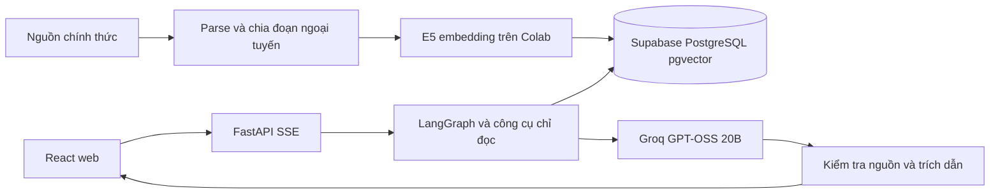

# Hanoi Land Law Assistant
## Báo cáo đồ án liên ngành — nguyên mẫu học thuật

**Sinh viên/nhóm, lớp, giảng viên:** điền thông tin trước khi nộp.

## 1. Bài toán và mục tiêu

Văn bản pháp luật phân tán, có thay đổi theo thời điểm và thường khó đọc với người không chuyên. Đồ án xây dựng web chatbot tiếng Việt hỗ trợ tìm căn cứ về bồi thường, hỗ trợ và tái định cư ở Hà Nội. Vành đai 4 là tình huống minh họa. Mục tiêu là minh họa một hệ thống AI có truy xuất và nguồn dẫn, không xác định quyền lợi pháp lý của từng hộ.

## 2. Đóng góp liên ngành

| Lĩnh vực | Công việc |
|---|---|
| Kỹ thuật dữ liệu | Thu thập nguồn chính thức, parse HTML/PDF, chia đoạn theo cấu trúc, metadata và phiên bản |
| Trí tuệ nhân tạo | Embedding E5, hybrid retrieval, LangGraph, tổng hợp có chứng cứ và kiểm tra trích dẫn |
| Kỹ thuật phần mềm | React/TypeScript, FastAPI, phiên hội thoại, SSE, Docker, kiểm thử và triển khai |
| Kiến thức miền | Phân biệt quy định chung, hồ sơ dự án, thời điểm áp dụng và dữ kiện cá nhân còn thiếu |

## 3. Kiến trúc

Backend và frontend chạy riêng trên Render và Cloudflare Pages. Supabase lưu corpus và hội thoại. E5 xử lý truy vấn trên CPU backend; không chạy mô hình sinh hoặc OCR trên Render. Không sử dụng công nghệ embedding khác trong cùng index.

## 4. Dữ liệu và retrieval

Corpus snapshot đang sử dụng có 69 tài liệu và 7.610 vector 384 chiều; danh mục nguồn nằm tại `data/sources.json`. Văn bản được lưu nguồn công bố, checksum, ngày kiểm tra và locator điều/khoản/trang. OCR và dữ liệu chưa đạt kiểm tra không được dùng để bù số lượng. Tin tiến độ dự án chỉ bổ sung bối cảnh.

Hybrid retrieval kết hợp tìm từ khóa PostgreSQL và vector bằng Reciprocal Rank Fusion. Kết quả truy xuất là ứng viên; không tự chứng minh điều khoản áp dụng cho hồ sơ cá nhân. Nguồn dẫn cho phép mở đoạn và văn bản gốc.

## 5. Agent và giao diện

Workflow xác định vấn đề, gọi công cụ truy xuất/mở điều khoản/quan hệ văn bản, tổng hợp rồi kiểm tra trước khi phát đáp án qua SSE. Có giới hạn thực thi để tránh vòng lặp. Trace hiển thị sự kiện và công cụ thực tế, không hiển thị suy nghĩ nội bộ.

Người dùng nhập câu hỏi, chọn ngày/dự án nếu cần, đọc đáp án và mở nguồn/trace. Hệ thống có thể hỏi lại hoặc trả lời có giới hạn. Baseline được giữ để minh họa nhưng không giả định agentic luôn tốt hơn.

## 6. Phương pháp đánh giá

Dùng lại 20 câu smoke có rubric và nguồn tham chiếu tại `data/evaluation/smoke.jsonl`. Chạy agentic qua API cloud, lưu câu trả lời, model, corpus, fingerprint, độ trễ và kết quả đối chiếu ID/đoạn nguồn. Tôn trọng giới hạn API công khai; checkpoint khi gián đoạn. Câu tiếp nối chạy sau câu trước trong cùng phiên khi bộ dữ liệu yêu cầu.

Kết quả mới được lưu riêng tại `reports/submission/evaluation.json`; bảng dễ đọc tại `reports/submission/results.md`. Kiểm tra máy chỉ xác nhận giao thức và nguồn tồn tại; chấm nội dung cần đọc câu trả lời và đối chiếu rubric. Những câu chưa rà soát phải ghi `awaiting_review`, không tính là đạt. Không lấy số liệu cũ, CLI hoặc model khác để thay thế.

## 7. Kết quả và bằng chứng

Checkpoint hiện tại đã chạy và rà soát 16/20 câu trên cloud: 12 pass, 2 partial, 2 fail theo rubric kỹ thuật; bốn câu còn lại chưa chạy do giới hạn lượt/ngày của API công khai. Tất cả trích dẫn xuất hiện trong 16 ca đều khớp đoạn nguồn qua endpoint tài liệu. Các ca không có trích dẫn không được tính như bằng chứng hỗ trợ kết luận. Không tính tỷ lệ chất lượng toàn hệ thống từ checkpoint này. Xem bảng kết quả hiện hành trong `reports/submission/`. Báo cáo backend/frontend được lưu riêng với ngày chạy. Nếu đánh giá cloud bị gián đoạn, số câu đã chạy và nguyên nhân phải được nêu rõ. Không đưa tỷ lệ chất lượng hoặc kết luận nghiệm thu khi chưa có đủ dữ liệu chấm.

Các receipt trước đây ở `reports/live-demo.json`, `reports/live-ui.json` và `reports/postgres-restore.json` là bằng chứng lịch sử, không tự động là kết quả của mã nguồn hiện tại.

## 8. Hạn chế

- Chưa được thẩm định pháp lý độc lập; dữ liệu là snapshot, có nguồn và quan hệ còn thiếu.
- Retrieval và giải tham chiếu có thể bỏ sót; một số câu hỏi bị trả lời giới hạn dù có căn cứ trong corpus.
- Nguồn đúng không tự bảo đảm mọi kết luận trong đáp án đúng.
- Hosting miễn phí có cold start; provider có thể timeout/quota. Không cam kết SLA.
- Không tính tiền bồi thường, xác định quy hoạch từng thửa hay xử lý hồ sơ cá nhân nhạy cảm.
- 20 ca có chọn lọc không đại diện mọi câu hỏi thực tế; không tuyên bố cải thiện so với baseline nếu chưa đo cùng cấu hình.

## 9. Hướng phát triển

Chỉ sau học phần: mở rộng đánh giá, thẩm định miền độc lập, cải thiện retrieval và giải tham chiếu, cập nhật nguồn có kiểm duyệt. Đây không phải điều kiện hoàn thành bản nộp.

## 10. Tài liệu tham khảo và tái lập

Nguồn pháp lý: `data/sources.json`, trang nguồn trong ứng dụng và metadata corpus. Công nghệ: FastAPI, LangGraph, PostgreSQL/pgvector, multilingual-e5-small, Groq hosted GPT-OSS 20B, React/Vite. Cài đặt theo README và phiên bản khóa trong repository. Không đưa khóa API hoặc token phiên vào báo cáo.
